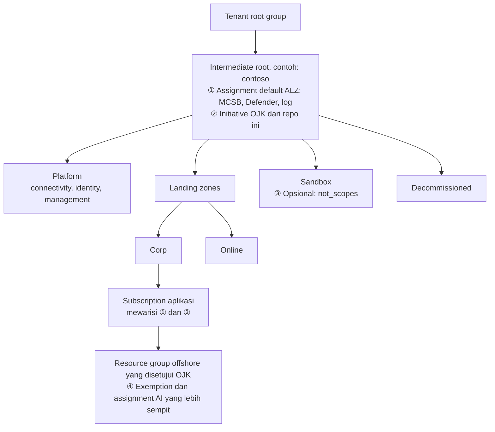

# OJK FSI Checklist (Mar 2026) → Azure Policy untuk Azure dan Azure Arc

Template Terraform dan Bicep yang mengubah bagian teknis dari *Checklist for Financial Institutions in Indonesia (March 2026)* menjadi satu Azure Policy initiative. Initiative ini berlaku untuk resource Azure dan juga untuk server on-premises (Windows/Linux, SQL Server) serta Kubernetes yang terhubung lewat Azure Arc.

Hasilnya:

- Satu tampilan compliance per grup kontrol OJK (OJK-01 sampai OJK-09) untuk Azure dan data center Anda.
- Query evidence yang bisa di-export ke CSV kapan saja, tanpa rekap manual mingguan.
- Penempatan di luar Indonesia yang sudah disetujui OJK tercatat sebagai exemption, lengkap dengan nomor surat dan tanggal kedaluwarsa.

> [!IMPORTANT]
> Repo ini adalah sample pribadi, bukan produk resmi Microsoft, dan tidak didukung oleh Microsoft Support. Isinya bukan nasihat hukum dan tidak menjamin kepatuhan terhadap regulasi OJK. Azure Policy hanya memeriksa konfigurasi teknis, dan tanggung jawab kepatuhan tetap ada di bank. Tinjau mapping, effect, dan rujukan regulasi bersama tim compliance sebelum memakai hasilnya sebagai bukti audit.

## Ringkasan

Hanya sebagian checklist yang bisa di-mapping. Isi checklist sebagian besar adalah due diligence, dokumen laporan ke OJK, dan klausul kontrak. Azure Policy hanya bisa memeriksa konfigurasi teknis milik bank.

<!-- counts:coverage:start -->

| Kategori baris checklist (bagian Bank) | Jumlah |
|---|---|
| Policy - direct (B-II #6(c): memantau kepatuhan terhadap persyaratan keamanan informasi) | 1 |
| Policy - partial (komponen teknisnya tercakup, sisanya dokumen atau proses) | 21 |
| Contract (Microsoft Agreement, DPA, FSA, SLA) | 27 |
| Bank process (surat, analisis, prosedur internal) | 17 |
| Microsoft evidence (laporan audit di Service Trust Portal) | 4 |
| Not applicable (khusus bank asing atau cabang bank asing) | 1 |
| **Total** | **71** |

<!-- counts:coverage:end -->

Artinya, 22 dari 71 baris (31%) punya kontrol teknis yang bisa dipantau oleh policy. Detail per baris ada di [`mapping/checklist-coverage.csv`](mapping/checklist-coverage.csv).

Singkatan kontrak di CSV: MBSA (Microsoft Business and Services Agreement), MCA (Microsoft Customer Agreement), DPA (Data Protection Addendum), FSA (Financial Services Amendment), SLA (Service Level Agreement), STP (Service Trust Portal).

<!-- counts:summary:start -->
Isi initiative: **70 policy** (69 built-in dan 1 custom) dalam **9 grup kontrol**. **23 policy** di antaranya berlaku untuk resource Azure Arc.
<!-- counts:summary:end -->

## Posisi terhadap Azure landing zone

Repo ini bukan landing zone dan tidak menggantikan [Azure landing zone (ALZ)](https://learn.microsoft.com/azure/cloud-adoption-framework/ready/landing-zone/). ALZ membangun fondasi: hierarki management group, subscription platform, jaringan, dan guardrail umum. Repo ini menambahkan satu lapisan compliance di atasnya: initiative OJK, exemption untuk penempatan offshore yang disetujui, dan query evidence. Repo ini tidak membuat management group, jaringan, atau resource platform.



1. **Assignment default ALZ** di intermediate root: Microsoft cloud security benchmark (MCSB), konfigurasi Defender for Cloud, log, dan remediation otomatis lewat `DeployIfNotExists` dan `Modify`.
2. **Initiative OJK** di management group yang sama, supaya subscription platform ikut tercakup. Log Analytics, firewall, dan DNS juga menyimpan data dan metadata bank.
3. **Sandbox** (opsional): tetap di-assign atau dikecualikan lewat `not_scopes`, sesuai keputusan tim compliance.
4. **Exemption** di resource group yang punya izin OJK, dengan nomor surat dan tanggal kedaluwarsa, plus assignment AI yang hanya mengizinkan deployment type yang disetujui.

Contoh: subscription aplikasi core banking di bawah Corp mewarisi ① dan ②. Setelah `effect_data_location = "Deny"`, storage account baru di Southeast Asia ditolak oleh ②. Foundry di resource group `rg-ai-apac` yang punya izin OJK tetap bisa memakai `DataZoneStandard` karena ④, tapi `GlobalStandard` tetap ditolak.

Untuk pilot, assign dulu ke satu subscription atau resource group. Kalau hanya sebagian workload yang diatur OJK, misalnya di grup usaha yang juga punya entitas non-bank, buat management group baru di bawah Landing zones untuk workload tersebut, lalu assign initiative di sana. Pola ini sama dengan contoh PCI di [Tailor the Azure landing zone architecture](https://learn.microsoft.com/azure/cloud-adoption-framework/ready/landing-zone/tailoring-alz).

### Pembagian peran

| | Azure landing zone | Repo ini |
|---|---|---|
| Struktur | Hierarki management group dan subscription platform | Memakai management group yang sudah ada |
| Policy | Guardrail umum (MCSB, Defender, log, Deny di Corp) dan remediation otomatis | Satu initiative yang dikelompokkan per kontrol OJK: mode laporan dulu, lalu Deny bertahap |
| Residensi data | Tidak ada pembatasan region di assignment default | Allowed locations dan deployment type AI, dengan exemption yang mencatat nomor surat OJK |
| Evidence | Compliance per assignment | Compliance per grup OJK, evidence per server, daftar penempatan offshore |
| Perubahan | Platform team | Platform team, dengan review dari tim compliance |

Sebagian besar policy di initiative ini memang sudah dievaluasi oleh ALZ. Dari 69 built-in, 64 juga ada di assignment default ALZ di intermediate root, kebanyakan lewat MCSB, dan 61 di antaranya aktif secara default. Angka ini dicek pada 4 November 2026 terhadap [Azure Landing Zones Library](https://github.com/Azure/Azure-Landing-Zones-Library) (`platform/alz`). Nilai tambah repo ini ada di:

- Policy yang tidak di-assign ALZ secara default:
  - *Allowed locations* dan *Allowed locations for resource groups*
  - custom policy deployment type AI
  - MFA untuk operasi delete di Azure Resource Manager
  - *Microsoft Defender for AI Services should be enabled*
  - *Audit diagnostic setting for selected resource types*
- Tiga policy customer-managed key yang di MCSB default-nya `Disabled`. Di initiative ini effect-nya `Audit`.
- Pengelompokan per kontrol OJK, query evidence, dan exemption yang mencatat izin OJK.

Policy yang sama di dua assignment dievaluasi terpisah, jadi tidak bentrok. Hasilnya muncul di kedua assignment. Untuk effect `Deny`, satu assignment yang menolak sudah cukup untuk menolak request.

### Yang perlu diselaraskan dengan ALZ

1. **Region default ALZ.** ALZ membuat resource lewat remediation, misalnya resource group dan alert rule Service Health. Pastikan region default ALZ ada di `list_of_allowed_locations` (contoh: `indonesiacentral`). Kalau tidak, remediation itu ditolak setelah `effect_data_location = "Deny"`.
2. **Nama resource group Service Health.** OJK-08 mencari alert rule di `rg-serviceHealthAlert`, sama dengan default ALZ. Kalau ALZ Anda memakai nama lain, set `service_health_alert_resource_group_name` (Terraform) atau `serviceHealthAlertResourceGroupName` (Bicep).
3. **Sandbox dan Decommissioned.** Putuskan bersama tim compliance apakah management group ini ikut di-assign atau dikecualikan lewat `not_scopes`.
4. **Pipeline terpisah.** Kelola repo ini dengan pipeline dan state Terraform sendiri, terpisah dari ALZ. Perubahan kontrol OJK butuh review dari tim compliance dan iramanya berbeda dari perubahan platform. Kalau Anda tetap ingin satu pipeline, tambahkan initiative ini ke library ALZ. Panduannya ada di [custom library (Terraform)](https://azure.github.io/Azure-Landing-Zones/terraform/howtos/customlibrary/) dan [modifying policy assignments (Bicep)](https://azure.github.io/Azure-Landing-Zones/bicep/howtos/modifyingpolicyassignments/).

## Isi folder

| Path | Fungsi |
|---|---|
| `mapping/ojk-policy-mapping.json` | Satu sumber mapping: grup kontrol, parameter initiative, dan 70 member policy dengan pin major version. Terraform dan Bicep sama-sama membaca file ini. |
| `mapping/checklist-coverage.csv` | 71 baris checklist beserta kategori, grup policy, dan bukti di luar Azure Policy. |
| `policies/ai-approved-deployment-types.json` | Custom policy yang membatasi deployment type Foundry/Azure OpenAI (`sku.name`) sesuai lokasi pemrosesan yang disetujui. |
| `terraform/` | Deploy di scope management group, subscription, atau resource group (azurerm `>= 5.0.0, < 6.0.0`). `.terraform.lock.hcl` mengunci provider ke versi yang sudah diuji. |
| `terraform/environments/demo-lab.tfvars` | Contoh nilai untuk demo lab: scope resource group, data location `Deny`, satu exemption offshore. |
| `bicep/` | Versi Bicep untuk scope management group dan subscription, plus template exemption. |
| `queries/` | Query Azure Resource Graph untuk evidence: compliance per grup OJK, server evidence, pending updates, dan penempatan offshore. |
| `examples/demo-lab/` | Lab untuk mencoba initiative: server Windows yang berperan sebagai server on-premises lewat Azure Arc, resource Azure, dan Foundry di lokasi offshore yang disetujui. |
| `scripts/validate_mapping.py` | Mengecek mapping: ID built-in, pin major version, status deprecated/preview, parameter, allowed values, CSV checklist, dan angka di README ini. `--offline` berjalan tanpa akses Azure. |
| `.github/workflows/validate.yml` | Pemeriksaan di setiap pull request: Terraform `fmt`, `validate` dan TFLint, Bicep build dan lint, serta `validate_mapping.py --offline`. Job opsional mengecek built-in terbaru dan menjalankan `terraform plan` kalau OpenID Connect (OIDC) ke Azure sudah diatur. |
| `.tflint.hcl` | Aturan TFLint untuk kedua folder Terraform. |
| `CHANGELOG.md` | Riwayat perubahan. Versinya sama dengan `metadata.version` initiative di mapping. |

## Grup kontrol

<!-- counts:groups:start -->

| Grup | Policy | Arc | Contoh isi | Rujukan |
|---|---:|---:|---|---|
| OJK-01 Data location | 3 | 1 | Allowed locations (termasuk metadata Arc), deployment type AI | POJK 11/2022 Pasal 35-36; checklist A-I #1, B-I #5, B-II #9 |
| OJK-02 Confidentiality | 12 | 2 | TLS/HTTPS, Transparent Data Encryption (TDE), protokol aman di Windows on-premises, customer-managed key (CMK, audit) | POJK 11/2022 Pasal 30(3)(b) |
| OJK-03 Network isolation | 9 | 4 | Public network access off, Private Link, Azure Arc Private Link Scope | Checklist B-I #1(a) |
| OJK-04 Identity and access | 11 | 1 | Multifactor authentication (MFA) untuk write/delete di Azure Resource Manager, owner hygiene, local auth off | Checklist A-I #5(c) |
| OJK-05 Security baseline | 6 | 6 | Azure compute security baseline Windows/Linux (Arc), pod security, Azure Policy extension di Arc-enabled Kubernetes | Checklist B-II #6(c) |
| OJK-06 Patch and vulnerability | 3 | 3 | Periodic update assessment, missing updates, temuan kerentanan SQL Server | Checklist B-II #6(c) |
| OJK-07 Monitoring and incident | 17 | 6 | Defender plans (Servers, SQL on machines, Containers, AI), security contact, Azure Monitor Agent (AMA) di Arc, resource logs | POJK 11/2022 Pasal 29(2), 30(3)(e); checklist A-I #7 |
| OJK-08 Provider monitoring | 1 | 0 | Service Health alert | POJK 11/2022 Pasal 30(5)(a) |
| OJK-09 Backup and resilience | 8 | 0 | Azure Backup, Key Vault soft delete/purge protection, zone redundancy | Checklist B-II #6(b) |

<!-- counts:groups:end -->

Rujukan SEOJK 21/2017 per kontrol tetap ada di description tiap grup, dengan tanda *as cited*. Semua effect default ada di mode laporan (`Audit` / `AuditIfNotExists`), jadi saat pertama kali di-assign tidak ada resource yang diblokir.

## Hal penting sebelum dipakai

1. **Rujukan regulasi.** POJK 11/2022 jadi rujukan utama. Checklist Maret 2026 masih merujuk SEOJK 21/SEOJK.03/2017, yang dicabut oleh PADK OJK 1/2026 sejak 1 Maret 2026. Petakan ulang rujukan itu ke Lampiran PADK 1/2026 bersama tim compliance sebelum hasil policy dipakai sebagai bukti audit. Dua hal dari FAQ PADK 1/2026 yang relevan:
   - FAQ no. 10 memberi contoh sistem manajemen intern yang boleh ditempatkan di data center (DC) atau disaster recovery center (DRC) di luar negeri, tetap dengan izin OJK. Contohnya aplikasi kolaborasi internal dan knowledge management system, termasuk yang memakai AI.
   - Pindah ke DC/DRC yang sudah pernah disetujui OJK cukup dengan notifikasi. Lokasi baru tetap perlu izin (FAQ no. 11).
2. **Indonesia Central tidak punya paired region.** Karena itu, OJK-09 mengecek zone redundancy, bukan geo-redundancy. Replikasi ke region lain berarti menempatkan DRC di luar Indonesia, dan itu butuh izin OJK.
3. **Deployment type AI default-nya hanya `Standard` dan `ProvisionedManaged`.** Keduanya memproses data di dalam geografi resource. `DataZone*` (misalnya Asia Pacific) dan `Global*` bisa memproses data di luar Indonesia. Izinkan lewat exemption offshore (lihat di bawah), bukan dengan melonggarkan parameter untuk semua resource group. Cek juga ketersediaan model `Standard` di Indonesia Central.
4. **Onboarding Arc harus memakai region yang diizinkan.** Resource Arc menyimpan metadata di region yang dipilih saat onboarding. Arc-enabled servers dan Arc-enabled Kubernetes bisa memakai `indonesiacentral`.
5. **Update assessment untuk Arc di Indonesia Central.** Periodic assessment Azure Update Manager berjalan untuk Arc-enabled servers di Indonesia Central. Assessment on-demand dan patching lewat Update Manager belum tersedia di region ini untuk Arc-enabled servers (dicek 4 November 2026). Cek [supported regions](https://learn.microsoft.com/azure/update-manager/supported-regions) sebelum merencanakan patching.
6. **6 policy masih preview**: 5 policy zone redundancy dan 1 policy Defender extension untuk Arc-enabled Kubernetes. Kalau preview tidak dipakai di production, set `effect_resilience = "Disabled"` dan pertimbangkan untuk mengeluarkan policy Defender extension tersebut.
7. **Tiga policy sengaja dikunci di `Audit`.** Deny di policy Arc Private Link Scope (servers dan Kubernetes) dan periodic assessment bisa menggagalkan onboarding Arc.
8. **"No data" bukan "compliant".** Beberapa policy membaca assessment dari Defender for Cloud atau Update Manager. Sebelum assessment ada, policy tersebut tampil sebagai non-compliant dengan reason `AssessmentNotFound`. Query `ojk-compliance-by-group.kql` memisahkannya sebagai *No data*.
9. **Hal-hal ini tidak dicakup Azure Policy**: Customer Lockbox (setting di Azure portal), Conditional Access dan PIM (Microsoft Entra), label dan data loss prevention (DLP) Microsoft 365 (Purview), serta resource native AWS/GCP. VM dan Kubernetes di AWS/GCP bisa ikut dicakup kalau di-onboard ke Arc.
10. **Policy lain di tenant tetap berlaku.** Kalau platform team Anda sudah punya policy Modify atau Deny (misalnya dari Azure landing zone), hasilnya ikut terlihat di resource yang dievaluasi initiative ini. Lihat [Posisi terhadap Azure landing zone](#posisi-terhadap-azure-landing-zone).
11. **Versi built-in dikunci per major version.** Setiap built-in di mapping punya `definitionVersion`, misalnya `2.*.*`. Update minor dan patch dari Microsoft tetap masuk otomatis. Major version baru, yang bisa mengubah perilaku policy, baru dipakai setelah Anda mengubah pin lewat pull request. `validate_mapping.py` memberi warning saat major version baru terbit.

## Prasyarat

### Tool

| Tool | Versi | Dipakai untuk |
|---|---|---|
| Terraform | 1.5 atau lebih baru (diuji dengan 1.17.1) | Deploy lewat Terraform |
| Provider azurerm | 5.x: modul utama 5.0.0 atau lebih baru, demo lab 5.5.0 atau lebih baru (lock file: 5.12.0) | Deploy lewat Terraform |
| Azure CLI | 2.x (diuji dengan 2.92.0) | Login, Bicep, `validate_mapping.py`, query evidence |
| Bicep CLI | diuji dengan 0.48.1 (`az bicep install`) | Deploy lewat Bicep |
| Python | 3.10 atau lebih baru | `validate_mapping.py` |
| PowerShell | 7 | Script demo lab |

Definisi built-in di mapping terakhir dicek terhadap Azure pada 4 November 2026 (`builtInsVerifiedOn` di mapping).

### Izin

| Kegiatan | Role minimum | Scope |
|---|---|---|
| Deploy initiative, assignment, dan exemption | [Resource Policy Contributor](https://learn.microsoft.com/azure/role-based-access-control/built-in-roles/management-and-governance#resource-policy-contributor) | Management group, subscription, atau resource group target |
| `terraform plan` di CI | Reader, plus Storage Blob Data Reader di container state | Scope target dan storage account state |
| `validate_mapping.py` dan query evidence | Reader | Subscription yang ingin dilihat |
| Demo lab | Owner, atau Contributor plus Resource Policy Contributor | Subscription lab (non-production) |

Managed identity milik assignment dibuat tanpa role. Role baru diperlukan kalau nanti Anda menambahkan effect `DeployIfNotExists` atau `Modify`.

## Prasyarat Arc

- **Arc-enabled servers**: Connected Machine agent sudah berisi machine configuration, jadi tidak perlu extension tambahan. Parameter `include_arc_machines = "true"` sudah diset untuk policy baseline dan protokol aman.
- **Azure VM**: policy machine configuration butuh initiative built-in *Deploy prerequisites to enable Guest Configuration policies on virtual machines* (`12794019-7a00-42cf-95c2-882eed337cc8`).
- **Kubernetes vanilla (CNCF) lewat Arc**: pasang Azure Policy extension (dicek oleh `base-arc-k8s-policy-extension`). Tanpa extension ini, policy Kubernetes tidak berjalan di cluster tersebut.
- **Konektivitas privat**: pakai Azure Arc Private Link Scope lewat ExpressRoute/VPN (grup OJK-03).
- **Biaya**: Update Manager dan machine configuration di Arc-enabled servers tidak dikenai biaya tambahan untuk Windows Server dengan Software Assurance yang sudah di-attest atau Windows Server pay-as-you-go. Di luar itu, dan juga untuk Defender plans, ada biaya per server. Cek harga terbaru sebelum rollout.

## Cara deploy

Validasi mapping terlebih dahulu. Mode `--offline` tidak butuh akses Azure. Mode live butuh `az login`.

```powershell
python scripts/validate_mapping.py --offline   # struktur mapping, CSV checklist, dan angka di README
python scripts/validate_mapping.py             # ditambah cek terhadap definisi built-in terbaru
```

### Terraform

```bash
cd terraform
cp terraform.tfvars.example terraform.tfvars   # isi subscription_id, scope_type, dan management_group_id atau resource_group_names
terraform init
terraform plan
terraform apply
```

| `scope_type` | Definisi dibuat di | Assignment |
|---|---|---|
| `management_group` (untuk production) | management group | satu assignment di management group |
| `subscription` | subscription | satu assignment di subscription |
| `resource_group` (pilot) | subscription | satu assignment per resource group di `resource_group_names` |

Di scope `resource_group`, kontrol level subscription (Defender plans, security contact, Service Health alert, MFA owner) tidak dievaluasi.

`.terraform.lock.hcl` mengunci provider ke versi yang sudah diuji. Untuk naik versi, jalankan `terraform init -upgrade`, uji hasilnya, lalu commit lock file yang baru. Dependabot membuka pull request untuk ini setiap bulan.

#### Remote state

Untuk production, simpan state di storage account dengan autentikasi Microsoft Entra ID (tanpa access key), versioning, dan soft delete. Lihat [Store Terraform state in Azure Storage](https://learn.microsoft.com/azure/developer/terraform/store-state-in-azure-storage). Tambahkan `terraform/backend.tf`:

```hcl
terraform {
  backend "azurerm" {
    use_azuread_auth = true
  }
}
```

Isi lokasi state di `terraform/backend.hcl`. File ini masuk `.gitignore`, jadi tidak ikut ter-commit ke repo publik.

```hcl
resource_group_name  = "<rg-tfstate>"
storage_account_name = "<storage-account>"
container_name       = "tfstate"
key                  = "ojk-policy.tfstate"
```

Lalu jalankan `terraform init -backend-config=backend.hcl`. Identity yang menjalankan `apply` butuh Storage Blob Data Contributor di container state.

Untuk job `live` di workflow `validate`, isi repository variable `TF_BACKEND_CONFIG` dengan nilai yang sama dalam bentuk argumen, misalnya `-backend-config=resource_group_name=<rg-tfstate> -backend-config=storage_account_name=<storage-account> -backend-config=container_name=tfstate -backend-config=key=ojk-policy.tfstate`. Workflow meneruskannya ke `terraform init`.

### Bicep

```powershell
# Management group (untuk production)
az deployment mg what-if --management-group-id <mg-id> --location indonesiacentral `
  --template-file bicep/main.mg.bicep --parameters bicep/main.mg.bicepparam
az deployment mg create  --management-group-id <mg-id> --location indonesiacentral `
  --template-file bicep/main.mg.bicep --parameters bicep/main.mg.bicepparam

# Pilot di satu subscription
az deployment sub create --location indonesiacentral `
  --template-file bicep/main.sub.bicep --parameters bicep/main.sub.bicepparam
```

Evaluasi awal butuh beberapa menit sampai puluhan menit. Hasil machine configuration dari server Arc bisa lebih lama.

```powershell
az policy state trigger-scan --no-wait
az policy state summarize --policy-assignment ojk-checklist-202603
```

## Melihat compliance dan mengambil evidence

1. Di Azure portal, buka **Policy** > **Compliance**, lalu pilih assignment *OJK FSI Checklist (Mar 2026)*. Tab **Controls** menampilkan OJK-01 sampai OJK-09 sebagai kontrol, dengan jumlah policy yang non-compliant. Pilih satu kontrol, lalu **Resource Compliance** untuk melihat resource dan server yang terdampak. Tombol **Export to CSV** mengambil daftar itu sebagai file.
2. Di **Resource Graph Explorer**, jalankan query di folder `queries/`, lalu pilih **Download as CSV**:

| Query | Isi |
|---|---|
| `ojk-compliance-by-group.kql` | Compliant, non-compliant, exempt, dan *No data* per grup OJK, dipisah antara Azure dan on-premises (Arc) |
| `server-evidence.kql` | Per server: OS, build, bulan update terakhir, sisa hari ke end of support, ESU eligibility, hasil security baseline dan secure protocols (*No data* kalau server belum melapor) |
| `server-pending-updates.kql` | Per server: jumlah security/critical update yang belum terpasang dan daftar KB-nya |
| `offshore-placements.kql` | Exemption offshore beserta nomor surat OJK dan sisa hari, plus resource dan resource group di region yang belum disetujui |

Initiative ini juga bisa ditambahkan sebagai custom standard di dashboard regulatory compliance Defender for Cloud (jalur berbasis Azure Policy, yang di dokumentasi Defender for Cloud disebut legacy). Report PDF di dashboard itu hanya tersedia untuk standard bawaan, jadi untuk custom initiative pakai **Export to CSV** atau query di atas.

## Rollout bertahap

1. **Report only**: assign ke management group dengan semua effect di mode audit. Onboard server dan cluster ke Arc di `indonesiacentral`, lalu ambil baseline compliance. Sebelum assign di management group production, coba dulu di subscription atau resource group pilot.
2. **Remediation**: aktifkan Defender plans, AMA, diagnostic settings, Azure Policy extension, dan periodic assessment lewat IaC atau lewat remediation ALZ. Semua member initiative ini berjalan dalam mode audit, jadi tidak ada effect DeployIfNotExists atau Modify yang aktif. Identity pada assignment disiapkan tanpa role apa pun.
3. **Enforce**: catat semua sistem offshore yang sudah disetujui sebagai exemption, lalu ubah `effect_data_location` menjadi `Deny`. Setelah itu, ubah `effect_preventive` / `effect_kubernetes` menjadi `Deny` secara bertahap per management group production. Sandbox bisa dikecualikan dengan `not_scopes`.

## Operasional dan perubahan kontrol

Setiap perubahan effect atau exemption sebaiknya lewat pull request: diff, review, dan riwayat merge menjadi jejak audit untuk perubahan kontrol.

- **Review.** `.github/CODEOWNERS` meminta review untuk setiap perubahan. Di salinan Anda, ganti isinya dengan tim platform dan tim compliance, lalu aktifkan branch protection agar review dan workflow `validate` wajib lulus sebelum merge.
- **Pemeriksaan otomatis.** Workflow `validate` menjalankan Terraform `fmt`, `validate`, TFLint, Bicep build dan lint, serta `validate_mapping.py --offline` di setiap pull request. Kalau repository variable `AZURE_CLIENT_ID`, `AZURE_TENANT_ID`, dan `AZURE_SUBSCRIPTION_ID` diisi ([OIDC](https://learn.microsoft.com/azure/developer/github/connect-from-azure-openid-connect), tanpa secret), job `live` juga mengecek built-in terbaru. Kalau `TFVARS_FILE` juga diisi, job itu menjalankan `terraform plan`, dengan remote state dari `TF_BACKEND_CONFIG` (lihat [Remote state](#remote-state)). Job `live` tidak berjalan untuk pull request dari fork.
- **Setiap minggu.** Job `live` berjalan terjadwal. Baca warning-nya: major version baru dari built-in perlu ditinjau sebelum pin diubah, dan perbedaan di `terraform plan` menunjukkan perubahan manual di luar pipeline.
- **Setiap bulan.** Tambahkan build Windows Server bulan itu ke `queries/server-evidence.kql` (caranya ada di komentar query), lalu gabungkan pull request Dependabot untuk GitHub Actions dan provider Terraform setelah pemeriksaan lulus.
- **Versi.** Naikkan `metadata.version` initiative di mapping dan catat di `CHANGELOG.md` setiap kali kontrol berubah. Nilai ini terlihat di definisi initiative di Azure, jadi auditor bisa mencocokkan versi yang sedang berjalan.

## Exemption untuk penempatan offshore

Baris B-II #9 (POJK 11/2022 Pasal 36(1)(j)) mengatur penempatan sementara di luar Indonesia beserta rencana pemindahan kembali. Kondisi ini dicatat sebagai exemption kategori `Waiver` di resource group, dengan nomor izin OJK di metadata dan tanggal kedaluwarsa.

- Exemption hanya membebaskan kontrol lokasi (`dl-allowed-locations`, `dl-allowed-rg-locations`).
- Deployment type AI **tidak** ikut dibebaskan secara otomatis. Isi `approved_ai_deployment_types` (misalnya `["DataZoneStandard"]`): resource group itu mendapat assignment policy AI sendiri yang hanya mengizinkan tipe tersebut, sehingga tipe di luar izin (misalnya `GlobalStandard`) tetap diblokir dengan pesan yang menyebut nomor surat OJK.
- Saat exemption kedaluwarsa, kontrol lokasi aktif lagi. Exemption tidak terhapus, jadi tetap ada sebagai catatan.

Terraform (`terraform.tfvars`):

```hcl
offshore_exemptions = {
  "ojk-dr-apac" = {
    resource_group_name          = "<rg-name>"            # atau resource_group_id untuk subscription lain
    ojk_approval_reference       = "<nomor surat OJK>"
    justification                = "Penempatan sementara; rencana pemindahan: <referensi dokumen>"
    expires_on                   = "2027-03-31T00:00:00Z"
    approved_ai_deployment_types = ["DataZoneStandard"]    # kosongkan kalau tidak ada AI
  }
}
```

Bicep:

```powershell
az deployment group create -g <rg-offshore> -f bicep/exemption-ojk-offshore.bicep `
  -p policyAssignmentId=<assignment-id> ojkApprovalReference="<nomor surat OJK>" `
     justification="Penempatan sementara; rencana pemindahan: <referensi dokumen>" `
     expiresOn=2027-03-31T00:00:00Z `
     approvedAiDeploymentTypes="['DataZoneStandard']" aiPolicyDefinitionId=<id custom policy ojk-ai-approved-deployment-types>
```

Policy exemption belum punya API version GA, jadi template exemption memakai versi preview (`2024-12-01-preview`).

## Demo lab

`examples/demo-lab` membuat lab kecil di subscription non-production Anda untuk mencoba initiative ini:

| Resource group | Isi | Assignment |
|---|---|---|
| `rg-ojkdemo-idc` (Indonesia Central) | Storage account, Key Vault, dan dua server Arc | Initiative, data location `Deny` |
| `rg-ojkdemo-sea-approved` (Southeast Asia) | Foundry (AIServices) dengan deployment `DataZoneStandard` | Initiative + exemption offshore (contoh) |
| `rg-ojkdemo-onprem-sim` (Indonesia Central) | Dua VM Windows Server 2016 yang berperan sebagai server on-premises: satu image Januari 2026, satu image terbaru | Tidak di-assign |

Lab ini membuat resource berbayar di subscription Anda: dua VM, NAT gateway, dan Foundry. Hapus lab setelah selesai.

Langkah:

```powershell
# 1. Lab
cd examples/demo-lab/terraform
terraform init
terraform apply -var="subscription_id=<subscription-id>"

# 2. Hubungkan kedua VM ke Azure Arc (PowerShell 7, Azure CLI sudah login)
cd ..
./scripts/Connect-ArcLab.ps1 -SubscriptionId <subscription-id> -SimResourceGroup rg-ojkdemo-onprem-sim `
  -ArcResourceGroup rg-ojkdemo-idc -Location indonesiacentral

# 3. Initiative di scope resource group
cd ../../terraform
terraform init
terraform apply -var-file="environments/demo-lab.tfvars" -var="subscription_id=<subscription-id>"
az policy state trigger-scan --resource-group rg-ojkdemo-idc --subscription <subscription-id> --no-wait
```

Script Arc mengikuti panduan [Evaluate Azure Arc-enabled servers on an Azure virtual machine](https://learn.microsoft.com/azure/azure-arc/servers/plan-evaluate-on-azure-virtual-machine) (hapus extension, set `MSFT_ARC_TEST`, blokir IMDS, matikan Azure guest agent). Cara ini hanya untuk lab. Untuk server on-premises sungguhan, pakai service principal khusus onboarding dan Azure Arc Private Link Scope.

> [!WARNING]
> `Connect-ArcLab.ps1` meneruskan access token Azure Resource Manager Anda ke VM lewat run command. Siapa pun yang punya akses administrator ke VM itu bisa membaca token tersebut selama masih berlaku (sekitar satu jam). Jalankan lab hanya di subscription non-production yang terpisah.

Yang bisa dicoba setelah lab jalan:

- Membuat storage account di Southeast Asia di `rg-ojkdemo-idc` ditolak dengan pesan POJK 11/2022.
- Deployment model `GlobalStandard` di `rg-ojkdemo-sea-approved` ditolak dengan pesan yang menyebut nomor surat OJK, sedangkan `DataZoneStandard` berhasil.
- Kontrol OJK-05 menampilkan kedua server Arc gagal security baseline, dan `server-evidence.kql` menampilkan server yang tertinggal update sejak Januari 2026.

`./scripts/Test-DemoLab.ps1 -SubscriptionId <subscription-id>` (dari `examples/demo-lab`) mengecek dua penolakan dan satu deployment yang berhasil di atas, lalu memicu compliance scan. Jalankan 1-2 jam sebelum demo. Kalau VM lab di-deallocate untuk menghemat biaya, server Arc berstatus *Disconnected* dan `server-evidence.kql` menampilkan *No data* untuk baseline. Start VM-nya lagi sebelum menjalankan script.

Hapus lab setelah selesai:

```powershell
cd terraform
terraform destroy -var-file="environments/demo-lab.tfvars" -var="subscription_id=<subscription-id>"
cd ../examples/demo-lab/terraform
terraform destroy -var="subscription_id=<subscription-id>"
```

## Kontribusi, keamanan, dan dukungan

- Cara berkontribusi: [CONTRIBUTING.md](CONTRIBUTING.md).
- Laporkan masalah keamanan secara privat lewat GitHub sesuai [SECURITY.md](SECURITY.md), jangan lewat issue publik.
- Pertanyaan dan bug: [SUPPORT.md](SUPPORT.md).
- Code of conduct: [Contributor Covenant 3.0](CODE_OF_CONDUCT.md).

## Lisensi

[MIT](LICENSE).

## Merek dagang

This project may contain trademarks or logos for projects, products, or services. Authorized use of Microsoft trademarks or logos is subject to and must follow [Microsoft's Trademark & Brand Guidelines](https://www.microsoft.com/legal/intellectualproperty/trademarks/usage/general). Use of Microsoft trademarks or logos in modified versions of this project must not cause confusion or imply Microsoft sponsorship. Any use of third-party trademarks or logos are subject to those third-party's policies.

## Sumber

- Microsoft, *Checklist for Financial Institutions in Indonesia* (March 2026), Service Trust Portal.
- OJK, [POJK 11/POJK.03/2022 tentang Penyelenggaraan Teknologi Informasi oleh Bank Umum](https://www.ojk.go.id/id/regulasi/Pages/Penyelenggaraan-Teknologi-Informasi-Oleh-Bank-Umum.aspx).
- OJK, [PADK 1 Tahun 2026 tentang Penyelenggaraan TI oleh Bank Umum](https://www.ojk.go.id/id/regulasi/Pages/PADK-1-Tahun-2026-Penyelenggaraan-Teknologi-Informasi-oleh-Bank-Umum.aspx) dan FAQ-nya: mencabut SEOJK 21/SEOJK.03/2017, berlaku 1 Maret 2026.
- Microsoft Learn, [Regulatory Compliance in Azure Policy](https://learn.microsoft.com/azure/governance/policy/concepts/regulatory-compliance).
- Microsoft Learn, [Azure Policy exemption structure](https://learn.microsoft.com/azure/governance/policy/concepts/exemption-structure).
- Microsoft Learn, [Azure Policy initiative definition structure](https://learn.microsoft.com/azure/governance/policy/concepts/initiative-definition-structure) (`definitionVersion`).
- Microsoft Learn, [Tailor the Azure landing zone architecture to meet requirements](https://learn.microsoft.com/azure/cloud-adoption-framework/ready/landing-zone/tailoring-alz).
- Microsoft Learn, [Security control mapping with Azure landing zones](https://learn.microsoft.com/azure/cloud-adoption-framework/ready/control-mapping/security-control-mapping).
- [Azure Landing Zones Library](https://github.com/Azure/Azure-Landing-Zones-Library).
- Microsoft Learn, [Deployment types for Microsoft Foundry Models](https://learn.microsoft.com/azure/foundry/foundry-models/concepts/deployment-types).
- Microsoft Learn, [Supported regions for Azure Update Manager](https://learn.microsoft.com/azure/update-manager/supported-regions).
- Microsoft Learn, [Windows Server Management enabled by Azure Arc](https://learn.microsoft.com/azure/azure-arc/servers/windows-server-management-overview).
- Microsoft Learn, [Create custom standards and recommendations in Defender for Cloud](https://learn.microsoft.com/azure/defender-for-cloud/create-custom-recommendations).
